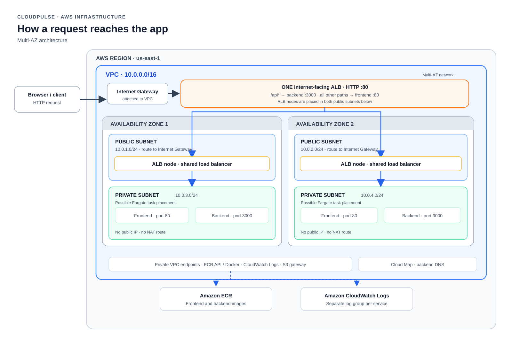

# CloudPulse AWS Infrastructure

Terraform infrastructure for running the CloudPulse frontend and backend as separate containers on Amazon ECS with AWS Fargate. GitHub Actions validates and applies the Terraform configuration; AWS resources are defined in reusable Terraform modules.

## Architecture at a glance



### Request and runtime flow

1. A client connects to the internet-facing Application Load Balancer (ALB) on HTTP port 80. The ALB spans two public subnets in separate Availability Zones.
2. The ALB forwards paths matching `/api*` to the backend target group on port 3000. All other paths go to the frontend target group on port 80.
3. ECS runs the frontend and backend as independent Fargate services in two private subnets, with no public IP addresses. Their target groups use IP targets, as required for `awsvpc`-networked Fargate tasks.
4. ALB health checks use `/` for the frontend and `/api/health` for the backend by default. Unhealthy targets are removed from load balancing until healthy again.
5. ECS pulls each container image from ECR and sends container logs to its CloudWatch log group. Private VPC endpoints provide access to ECR, CloudWatch Logs, and S3 without a NAT gateway.
6. Cloud Map registers the backend service in a private DNS namespace. The application is also exposed through ALB path routing; whether the application itself uses the private DNS name depends on its code/configuration.

## AWS resources and design

| Area | What Terraform creates |
| --- | --- |
| Network | One VPC (`10.0.0.0/16` by default), two public and two private subnets across the first two available Availability Zones, an Internet Gateway, route tables, and VPC endpoints. |
| Ingress | An internet-facing ALB, HTTP listener, frontend/backend target groups, and a listener rule for `/api*`. |
| Workloads | One ECS cluster, one ECR repository shared by both images, two Fargate task definitions and services, and CPU- and memory-based target-tracking autoscaling policies. |
| Access control | An ALB security group that allows configured client CIDRs on the listener port; task ingress is limited to the ALB security group on the frontend/backend ports. |
| Operations | CloudWatch log groups (7-day retention by default), backend Cloud Map service discovery, and optional AWS Budget alerts. |
| State | Terraform's remote S3 backend, configured for encryption and S3 lockfiles. The backend bucket must already exist. |

Default ECS task sizing is 0.25 vCPU and 512 MiB per service. Autoscaling defaults to 1–4 tasks per service, targeting 60% average CPU and 70% average memory. These are configuration defaults, not capacity guarantees.

The private subnets have no NAT gateway or default internet route. The configured endpoints support image pulls and log delivery; workloads should not be assumed to have general outbound internet access. This keeps the demo topology simpler and avoids NAT gateway charges, but applications that need external APIs or package downloads at runtime need an egress design.

## GitHub Actions deployment

The workflows are in [`.github/workflows/deploy.yml`](.github/workflows/deploy.yml) and [`.github/workflows/destroy.yml`](.github/workflows/destroy.yml).

### Deploy workflow

- **Pull request:** checks Terraform formatting, initializes without the remote backend, and validates the configuration. It does not access AWS, create a plan, or deploy.
- **Push to `main`:** runs the same validation, assumes the configured AWS role with GitHub OIDC, verifies the caller identity, selects or creates a repository/branch-specific Terraform workspace, creates a saved plan, and applies that plan.
- **Manual run:** `workflow_dispatch` can run validation and the OIDC identity check on `main`; the apply job is intentionally limited to a push event to `main`.
- Runs that modify Terraform state share a concurrency group, preventing overlapping apply/destroy operations.

GitHub OIDC avoids long-lived AWS access keys in GitHub. The AWS role's trust policy should restrict federation to this repository and the intended branch/environment, and its permissions should be limited to the Terraform-managed resources and state backend.

### Prerequisites

Before deploying, configure:

1. An AWS account and region, plus an IAM role trusted for GitHub Actions OIDC. The role needs permissions for the managed infrastructure and access to the Terraform state bucket.
2. The GitHub Actions repository secret `AWS_ROLE_ARN`, containing that role's ARN.
3. The pre-created S3 bucket named in the `backend "s3"` block in [`providers.tf`](providers.tf). Consider enabling bucket versioning and restricting access to the CI role; Terraform configures encryption and lockfiles but does not create or configure the bucket.
4. ECR images for **both** services, tagged with the configured `frontend_service.image_tag` and `backend_service.image_tag` values. The defaults are `frontend-latest` and `backend-latest`.
5. If enabling the optional budget, the `BUDGET_ALERT_EMAIL` GitHub secret and an activated AWS cost-allocation tag matching the `Project` tag. Budget creation is disabled by default.

> **Image pipeline boundary:** The current GitHub Actions workflow does not build, scan in CI, or push application images. It only provisions infrastructure. Build and push both images to the Terraform-created ECR repository before the ECS services can start successfully. ECR image scanning on push is enabled by default.

The Terraform backend uses `us-east-1`; the AWS provider defaults to `us-east-1` as well. If changing regions, update the backend configuration and workflow AWS region consistently. Terraform workspaces are derived from the repository and branch names; CI creates a workspace such as `ci-<repository>-main`.

## Run Terraform locally

Install Terraform `>= 1.10.0`, configure AWS credentials with permissions for the infrastructure and state bucket, and ensure the backend bucket exists. From the repository root:

```shell
terraform init
terraform validate
terraform plan
terraform apply
```

The optional budget is disabled by default. The `budget_alert_email` input is nevertheless required by the current Terraform variables, even when the budget is disabled; provide it through an environment variable or an untracked `*.tfvars` file before running the commands. To enable the budget, also set `enable_cloudpulse_budget = true`. Do not commit credentials, email addresses, Terraform state, plans, or variable files containing sensitive values.

Useful outputs after apply:

- `alb_dns_name` — generated ALB hostname for demo/testing access. For production, give users a Route 53 custom domain instead of the raw ALB DNS name.
- `ecr_repository_uri` — shared ECR URI for both application images.
- `ecs_cluster_name` and `vpc_id` — identifiers for AWS operations and troubleshooting.

Destroying the infrastructure removes resources managed by the selected workspace. The manual destroy workflow is restricted to `main`, uses the same workspace naming and state concurrency group, and runs `terraform destroy -auto-approve`. Confirm the selected repository, branch, and workspace before running it. The remote state bucket itself is not created by this configuration.

## Configuration and code map

Root-level variables in [`variables.tf`](variables.tf) control the region, network CIDRs, ALB routing, ECS task/service settings, autoscaling, logs, service discovery, and optional budget. Defaults are intended for a small demo and should be reviewed before a production deployment.

- [`main.tf`](main.tf) wires the modules together.
- [`modules/network`](modules/network) provisions the VPC, subnets, routes, and VPC endpoints.
- [`modules/security-groups`](modules/security-groups) defines ALB and task traffic boundaries.
- [`modules/load-balancer`](modules/load-balancer) configures the ALB, listener, routing rule, target groups, and health checks.
- [`modules/ecs`](modules/ecs) provisions ECR, ECS/Fargate services and task definitions, CloudWatch logs, Cloud Map, and autoscaling.
- [`modules/iam`](modules/iam) provisions ECS task/service roles.
- [`cost-management.tf`](cost-management.tf) optionally creates the monthly AWS Budget.
- [`providers.tf`](providers.tf) configures AWS provider tags and the remote Terraform backend.

## Security, availability, and production considerations

- **DNS and HTTPS:** The ALB-generated DNS name is for demo/testing, not the production user-facing URL. In production, use a custom domain in Route 53 with an Alias record targeting the ALB, and enable HTTPS with an ACM certificate, an HTTPS listener, and an HTTP-to-HTTPS redirect.
- **Public ingress default:** The default ALB ingress CIDR is `0.0.0.0/0`. Restrict it if the app should not be publicly reachable.
- **Multi-AZ, single task by default:** Subnets and the ALB span two Availability Zones, but each service starts with one desired task. Autoscaling can add tasks under load; for stronger availability, set a higher minimum/desired count and confirm application readiness and capacity.
- **No database is provisioned:** This repository contains no database, data persistence, or application secret management resources.
- **Task role scope:** The task execution role is used for image pulls and log delivery. The task definitions do not configure a separate application task role; add one with least-privilege permissions if containers need to call AWS APIs.
- **Review IAM before production:** The configuration also creates an ECS service role attached to a managed policy. Verify whether this role/policy is required for the selected ECS setup and reduce permissions where possible.
- **State and budget:** Terraform state can contain sensitive infrastructure data. Protect the S3 bucket and CI role. AWS Budgets are alerts, not hard spending caps, and tag-based cost filters only include costs after the tag is activated and recognized by billing.
- **Image immutability:** Defaults use mutable `*-latest` tags. For repeatable releases, use unique version or commit-SHA tags and update Terraform to deploy the intended image versions.
